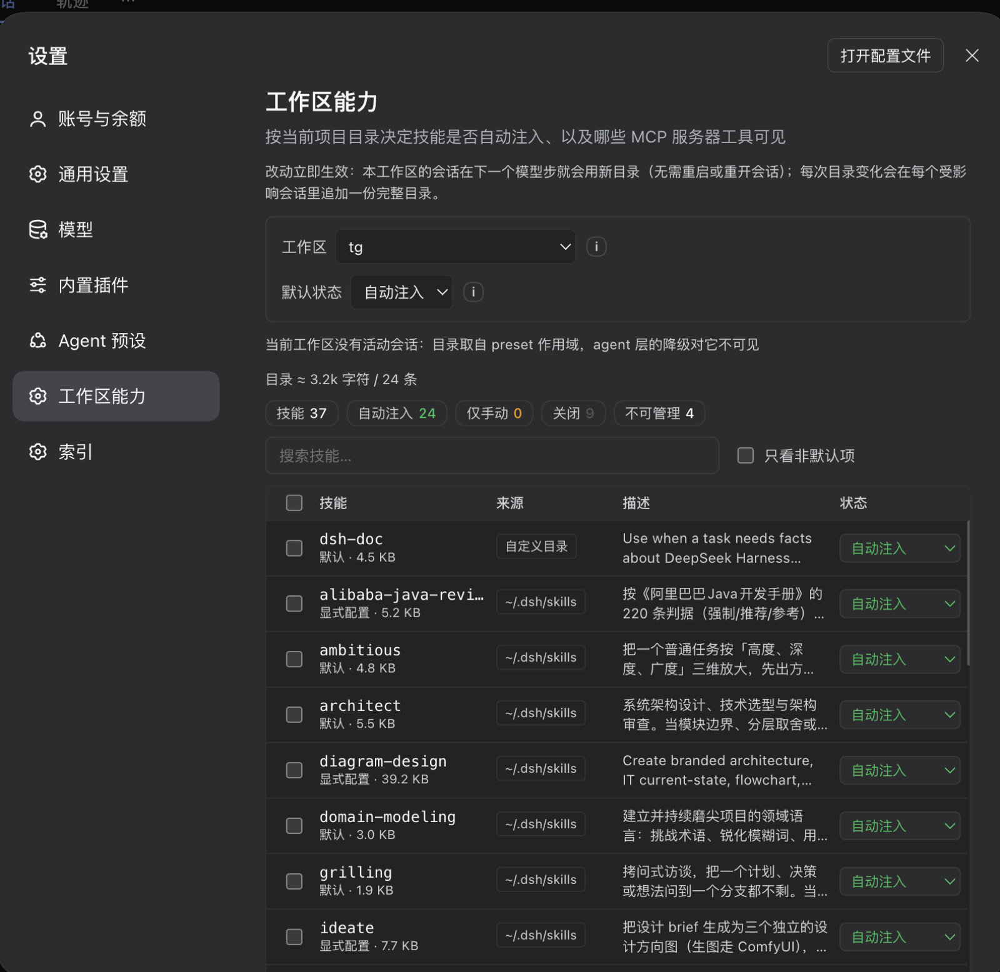
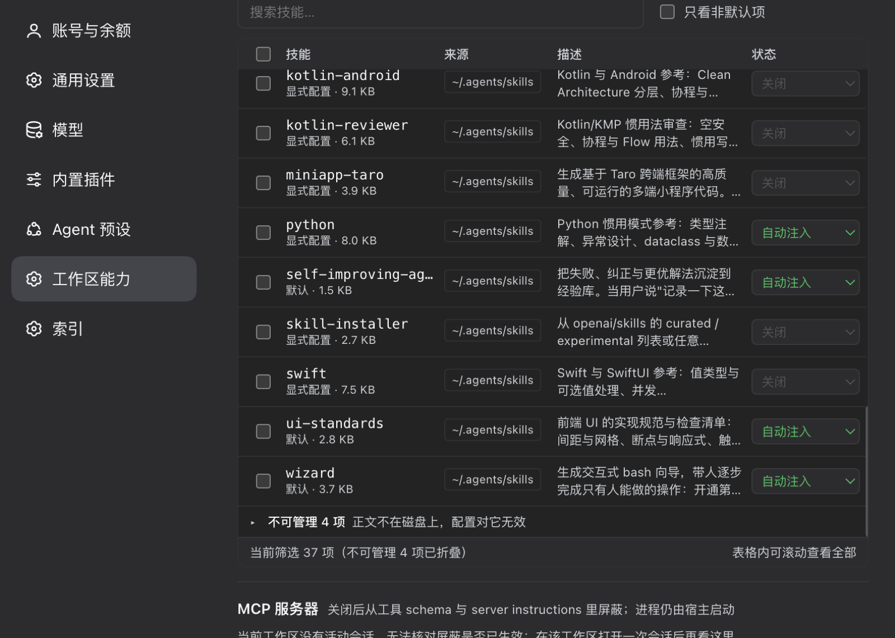

# dsh-workspace-capabilities

[](https://github.com/HosheaLi/dsh-workspace-capabilities/actions/workflows/ci.yml) [](https://www.npmjs.com/package/dsh-workspace-capabilities) [](https://github.com/deepseek-ai/deepseek-harness/releases) [](LICENSE)

Per-workspace control over which skills enter the model catalog and which MCP servers stay hidden in [DeepSeek Harness](https://github.com/deepseek-ai/deepseek-harness) — **both tool schemas and the MCP server-instruction prompt sections are masked**.

In one sentence: mark a skill `manual` and the model no longer sees it, while a manual `/skill-name` still injects the full text. Most "override" skill plugins disable it completely (`/name` dies too); keeping that escape hatch is the point of this plugin.

[中文 README](README.md)

> **Release status (2026-11-19)**: the GitHub repository and the npm package are not public yet.
> The npm, index, and Git install commands below become usable once they are; today, use the
> local source install described under Install.

- Zero runtime dependencies: the host half uses Node built-ins only, the client half uses the platform-provided `react`
- Tested on DSH `0.2.2-rc.5` (Desktop, macOS, 2026-11-19); allowed range `>=0.2.1-rc.2 <0.3.0`

## Three states

| State | In `<available_skills>` | `skill` tool | `/name` | Use |
| --- | --- | --- | --- | --- |
| `pinned` (default) | ✅ | ✅ | ✅ | Skills this workspace usually needs; let the model choose |
| `manual` | ❌ | ❌ | ✅ | "Stop auto-injecting"; invoke from the panel or by typing `/name` |
| `off` | ❌ | ❌ | ❌ | Not relevant to this workspace at all |

Default is `pinned`: installing the plugin changes nothing until you mark something.

## Install

> **Release status (2026-11-19)**: not yet on npm or a public repository. The commands in this
> section are the post-release paths; the local source install works today.

After the npm release:

```sh
dsh plugin --profile web add dsh-workspace-capabilities
```

Desktop manages its reserved `desktop` profile itself: install it from **Plugins** in the sidebar.

Without npm, add this plugin index under **Settings → Plugins → Experimental plugins → Custom plugin indexes**, then install from **Discover**:

```text
https://cdn.jsdelivr.net/gh/HosheaLi/dsh-workspace-capabilities@main/index.json
```

Or install a pinned commit/tag directly:

```sh
dsh plugin --profile web add "git+https://github.com/HosheaLi/dsh-workspace-capabilities.git#v0.1.0"
```

Local source install (works today, development):

```bash
ln -sfn ~/code/dsh-workspace-capabilities ~/.dsh/profiles/desktop/node_modules/dsh-workspace-capabilities
```

Then add the row in the profile's `cordis.patch.yml`:

```yaml
- insert:
    - id: workspace-scope
      name: 'dsh-workspace-capabilities'
```

A host restart is required after adding the bundle (both halves assemble at startup).

## Configuration

Two layers, project first. Keys are skill names or wildcards (`*` any run, `?` one character):

```jsonc
// <project root>/.dsh/skills-scope.json — commit it, share it with the team
{
  "version": 1,
  "default": "pinned",
  "skills": {
    "writing-for-agents": "manual",
    "comfy-*": "off"
  },
  "mcp": { "comfy": false }
}
```

```jsonc
// $DSH_HOME/settings/skills-scope.json — machine-wide defaults
{ "version": 1, "default": "pinned", "skills": {}, "mcp": {} }
```

- **Project root** follows DSH: the nearest ancestor containing `.git`, otherwise the current cwd.
- **`mcp: false` controls two layers**: it denies `mcp__<server>__*` from the agent's tool schema and registers an empty `mcp:<server>` prompt section in that agent's scope, shadowing the server instructions registered host-globally by `dsh-mcp-client`. Both save tokens; **the process keeps running** — the server belongs to the host composition.
- **Matching order**: exact name > wildcards (longest matching pattern wins) > `default`.
- **`default` is only written when set explicitly**: writing an implicit default would materialize it and let a project-level default silently override your global `manual`/`off`.
- **Writes**: `mkdir -p` → temp file → `rename`; read-modify-write is serialized per path; unknown top-level keys are preserved; an existing file that is not valid JSON is **refused, not overwritten**.
- The panel writes the **project layer** (or the global layer when no project exists). When the project root is the home directory it skips the project layer so the two layers cannot silently overwrite each other.

## Panel






| Where | What |
| --- | --- |
| Settings → **Workspace capabilities** | Header, workspace and default-state rows, catalog size and per-state counts, search and "non-default only", skill table (checkbox / name and metadata / source / description / state dropdown, with non-manageable rows folded into their own group), batch bar, MCP server switches with a "visible x/y" check |
| **`/skill`** button right of the composer | Search and pick → inserts `/skill-name ` into the composer and focuses it |

- State is a native dropdown: auto-inject / manual only / off; a row with an exact config key also offers "remove explicit key (→ fallback)" when deleting it actually changes the effective state.
- Batch changes are **one atomic RPC**; skipped rows are reported with a reason.
- Sorting (panel and `/skill` share it): manageable first → source (project `.dsh` → project `.agents` → custom → user `.dsh` → user `.agents` → bundled → runtime) → name. The first five match the official `dsh-skill-filesystem` precedence, so **panel order equals real conflict precedence**.
- Changes take effect at the next model step. Every catalog change **appends one full catalog message** to the session (durable, not diffed), so batch your edits; the panel shows an estimate.

## How it differs from `dsh-workspace-scope`

Both plugins solve per-workspace skill/MCP policy; they cannot be installed together (same client slot id). This one adds:

| | dsh-workspace-capabilities | dsh-workspace-scope |
| --- | --- | --- |
| Global defaults + project overrides | ✅ two layers, wildcards | ❌ per-workspace file only |
| MCP server instructions | ✅ prompt section masked | ❌ tool schemas only |
| State model | ✅ three states, real `off` (kills `/`) | ⚠️ binary; disabled still keeps `/` |
| Skill source column and grouping | ✅ | ❌ |
| Session `cd` (`workingDirectory`) | ✅ policy follows the current directory | ❌ initial `cwd` only |
| Invalid config file | ✅ refuses to write | ⚠️ falls back to defaults |
| `serverName` containing `__` | ✅ matched against known servers | ❌ documented as unsupported |
| Distribution | index / git (npm package pending) | npm one-liner |

## Compatibility

| DSH | Status |
| --- | --- |
| `0.2.2-rc.5` (Desktop, macOS) | tested in daily use; 163 tests pass (2026-11-19) |
| `0.2.1-rc.5` (Web) | same host contracts; expected to work, not re-verified on Web |
| `>=0.2.1-rc.2 <0.3.0` | allowed by `engines.dsh` |
| `<0.2.1-rc.2` | unsupported |

## Development

```sh
npm test           # 163 tests: 140 unit pass, 23 integration skipped without a runtime
npm run test:coverage
npm run build:index   # regenerate the market index after a release commit
```

Coverage (2026-11-19): **lines 99.21% / branches 88.04% / functions 94.33%**; CI requires
95% / 90% / 80%. CI also runs on Windows; a `v*` tag publishes to npm and creates a GitHub
Release.

## License

MIT, see [LICENSE](LICENSE).
