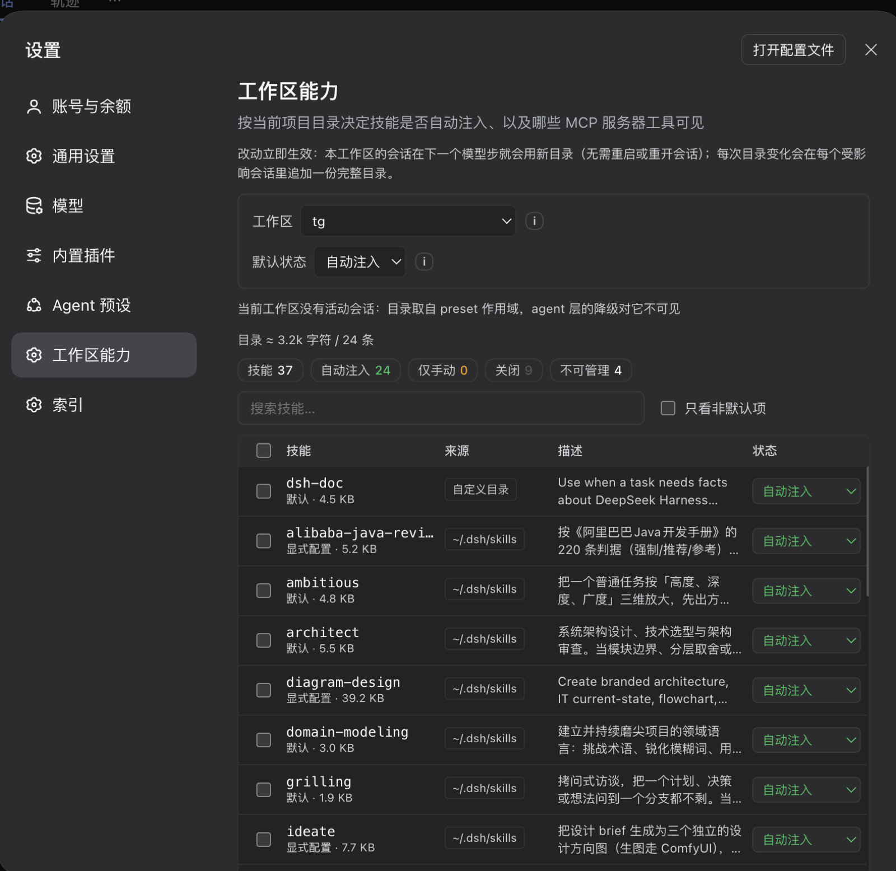
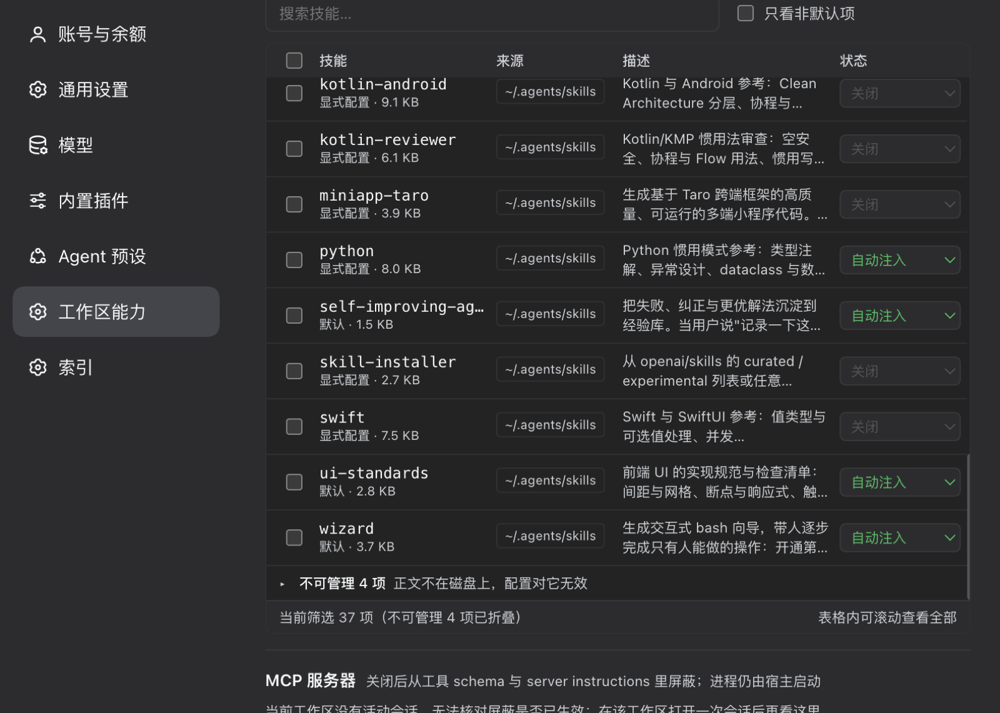

# dsh-workspace-capabilities

[](https://github.com/HosheaLi/dsh-workspace-capabilities/actions/workflows/ci.yml) [](https://www.npmjs.com/package/dsh-workspace-capabilities) [](https://github.com/deepseek-ai/deepseek-harness/releases) [](LICENSE)

[English](README.en.md)

按**工作区（项目目录）**决定技能是否进入模型目录，并屏蔽与本项目无关的 MCP 服务器 —— **工具 schema 与 server instructions 提示词段都屏蔽**。

> **当前发布状态（2026-11-19）**：GitHub 仓库与插件索引已公开，[索引安装](#方式一从插件市场索引安装发布后可用)
> 今天可用；npm 包与 `v0.1.0` tag 尚未发布，npm / Git 固定版本安装在其后生效。

一句话语义：把某个技能标成 `manual` 之后，**模型看不见它，但 `/技能名` 手动调用照样注入全文**。
常见的「覆盖型」技能插件选择彻底停用（`/名` 一起死掉），这一档是本插件的核心增量。

> **与 `dsh-workspace-scope` 的关系**：npm 上已有另一个独立实现 `dsh-workspace-scope`
> （Ri0n72Y 维护），与本项目没有代码或配置关系。本项目从 `0.1.0` 起使用
> `dsh-workspace-capabilities`；包名不同，但注册了同一个 client slot id，不能同时安装。

- 版本 `0.1.0`（首个发布版，发布状态见上；变更见 [`CHANGELOG.md`](CHANGELOG.md)）
- 零运行时依赖：host 半边只用 node 内置模块，client 半边只依赖平台种子 `react`
- 宿主基线 `@deepseek-ai/*` 0.2.1-rc.2（2026-10-17 复核），当前桌面端 0.2.2-rc.5 已实测（2026-11-19）

## 兼容性

| DSH | 状态 |
| --- | --- |
| `0.2.2-rc.5`（Desktop / macOS） | 日常使用；163 个用例（140 通过 / 23 集成跳过）（2026-11-19） |
| `0.2.1-rc.5`（Web） | 宿主契约相同，预期可用；未在 Web 实机复核 |
| `>=0.2.1-rc.2 <0.3.0` | `engines.dsh` 允许范围 |
| `<0.2.1-rc.2` | 不支持 |

只在 macOS / Linux 上验证。Windows 上的**设置面板未适配**：`lib/rpc.js` 用 POSIX 绝对路径判定
`cwd`，`C:\...` 会被拒绝；因此 CI 只跑 Ubuntu，Windows 兼容性不在本版承诺内。

## 三种状态

| 状态 | 进 `<available_skills>` | `skill` 工具 | `/名` 手势 | 用途 |
| --- | --- | --- | --- | --- |
| `pinned`（默认） | ✅ | ✅ | ✅ | 本工作区常用技能，交给模型自选 |
| `manual` | ❌ | ❌ | ✅ | 「关闭自动注入」，靠面板点选或手打调用 |
| `off` | ❌ | ❌ | ❌ | 与本工作区完全无关 |

默认值是 `pinned`：装上插件不产生任何行为突变，再由你在工作区里把不需要的标掉。

## 和 `dsh-workspace-scope` 的区别

两者都做“按工作区控制技能 / MCP”，**不能同装**（注册了同一个 client slot id）。功能重合之外，本插件多出：

| | 本插件 | dsh-workspace-scope |
| --- | --- | --- |
| 全局默认 + 项目覆盖 + 通配符 | ✅ | ❌ 只有每工作区一个文件 |
| MCP server instructions | ✅ 提示词段遮蔽 | ❌ 只 deny 工具 schema |
| 三态 / 真正的 `off` | ✅ | ⚠️ 二态；关闭后仍保留 `/` |
| 技能来源列与分组 | ✅ | ❌ |
| 会话内 `cd` 跟随 | ✅ | ❌ 只认初始 `cwd` |
| 非法配置文件 | ✅ 拒绝写入 | ⚠️ 回落到默认值 |
| `serverName` 含 `__` | ✅ 按已知服务器匹配 | ❌ 明确不支持 |
| 分发 | 索引 / git（npm 待发布） | npm 一行安装 |

## 配置

两级，项目级优先，键为技能名或通配符（`*` 任意长度、`?` 单字符）：

```jsonc
// <项目根>/.dsh/skills-scope.json —— 随仓库提交，团队共享
{
  "version": 1,
  "default": "pinned",
  "skills": {
    "writing-for-agents": "manual",
    "comfy-*": "off"
  },
  "mcp": { "comfy": false }
}
```

```jsonc
// $DSH_HOME/settings/skills-scope.json —— 全局默认
{ "version": 1, "default": "pinned", "skills": {}, "mcp": {} }
```

- **项目根**沿用 DSH 判定：最近的含 `.git` 的祖先目录，没有则用当前 cwd。
- **`mcp` 开关同时管两层**：`false` 既把该服务器的 `mcp__<server>__*` 工具从 agent 的
  schema 里 deny 掉，也在该 agent 作用域注册同名的空 `mcp:<server>` 提示词段，遮蔽
  `dsh-mcp-client` 在 host 层注册的 server instructions。两层都省 token，但**进程不会被停掉**
  —— MCP server 由 host 组合持有，与本插件无关。
- **匹配优先级**：精确名 > 通配符（多个命中取最长模式）> `default`。
- **`default` 只在显式设置过时才落盘**：缺省写一个默认值等于把它物化成显式配置，而项目层优先，
  于是「在项目里关掉一个技能」会顺带盖掉你全局设的 `manual`/`off`。
- **写盘**：`mkdir -p` → 写临时文件 → `rename`；读-改-写整条链在同一路径上串行；顶层未知键原样
  保留；文件存在但不是合法 JSON 时**拒绝写入并报错**，绝不拿空配置覆盖你手工修的内容。
- 面板只写**项目层**（没有项目层时才写全局层）。项目根等于 home 时跳过项目层，只读写全局配置
  —— 否则两级会变成同一个文件而静默互相覆盖。

路径分离与匹配算法的完整理由见 [`docs/architecture.md`](docs/architecture.md) 第 4 节。

## 界面






| 位置 | 内容 |
| --- | --- |
| 设置 → **工作区能力** | 页头（标题 / 简介 / 生效说明）、两行配置区（工作区 · 默认状态，各带信息图标）、目录体量与三态统计、搜索与「只看非默认项」、技能表格（勾选框 / 名称与元信息 / 来源 / 描述 / 状态下拉，不可管理项独立折叠）、批量条、MCP 服务器开关（含「可见 x/y」核对） |
| 输入框右侧 **`/技能`** 按钮 | 搜索 + 点选 → 插入 `/技能名 ` 到输入框并回焦 |

几个要点：

- **面板排布**：标题与简介各占一行（字号对齐原生设置页分区 18px / 13px），生效说明紧随其后；
  配置区改成「工作区」「默认状态」两行，工作区下拉只显示名称，完整路径与写入层收进右侧信息图标，
  默认状态右侧的信息图标解释三态定义。统计胶囊在目录体量下一行、左对齐；搜索栏再下移一行，
  紧贴表格。
- **技能表分组**：可管理行按 host 顺序直接铺开，`bundled` / `runtime` 等**不可管理项单独收进
  表格末尾的折叠分组**（默认折叠，组头给数量与原因）。来源仍是独立列，行序仍由 host 排好（见下）。
  条目超过一屏（约 `46vh / 42px` 行高）时表格底部常驻「当前筛选 N 项 · 表格内可滚动查看全部」
  （macOS 的 overlay 滚动条默认隐藏，不提示会像在十几行处突然结束）。
- **状态列是原生下拉**：自动注入 / 仅手动 / 关闭；该行有精确配置键时多一项「**删除显式配置
  （→ 回落态）**」——回落态由 host 按**写入层**算好，标注删掉这个键之后实际会落到哪一态。
  键在另一层时这一项不出现（删了不改变生效状态，host 返回 `noop` 而不是给个点了没反应的动作）。
- **勾选列 + 批量条**：表头勾选框作用于**当前筛选结果里的可管理行**；勾选集跨搜索/筛选保留，
  切换工作区与写盘成功后清空。批量条分三行：选中数量与目标状态、本次目录变化说明（左对齐）、
  底部三个操作按钮。批量走**一次**原子 RPC，逐条回报被跳过的行与原因。
- **排序三层**（面板与 `/技能` 浮层共用同一顺序）：可管理优先 → 来源（项目 `.dsh` → 项目
  `.agents` → 自定义 → 用户 `.dsh` → 用户 `.agents` → 包内置 → 运行时注册）→ 名称。前五个来源的
  顺序与官方 `dsh-skill-filesystem` 的优先级完全一致，所以**面板顺序 = 同名冲突时的真实优先级**。
- **面板显示的状态一律以本插件配置文件为准**，不拿注册表返回的 invocation 反推；两者不一致时
  该行会给一个「未生效?」标记。
- **描述与来源**：描述默认 2 行截断，不再提供「展开 / 收起」按钮，**hover 400ms 弹出完整描述 +
  来源 + 正文路径**的浮层，浮层可滚动、可选中复制（鼠标移入会取消关闭）。来源独立成列
  （胶囊样式，完整路径在 `title` 里），不再混进描述。不可管理行**也能看到自己的描述**，
  不可管理的原因挂在徽标 tooltip 上。
- **写盘回执**分三种，避免自相矛盾：`已改 N 项`（有跳过时追加 `；跳过 M 项：名字（原因）`）／
  `未做任何改动；跳过 M 项：…`／`所选技能已经是目标状态，未写盘`。
- 工具栏左对齐常驻三态统计（`技能 40 / 自动注入 29 / 仅手动 0 / 关闭 7 / 不可管理 4`）；目录体量
  估算（本机实测 `目录 ≈ 3.2k 字符 / 24 条`）改成上一行的纯文本，字符数按宿主渲染规则估算，token
  换算只在 tooltip 里。批量条给出本次动作的 Δ。

## 改配置对进行中的会话意味着什么

一句话：**立即生效，但每次目录变化都会在会话里永久追加一份完整目录 —— 所以批量改，别反复横跳。**

技能目录不是系统提示词的一部分，而是会话里一条普通的 durable **user 消息**，宿主在**每个模型步**
重算它的 digest：

| 你做了什么 | 会话里发生什么 |
| --- | --- |
| 写盘了但目录内容没变 | **完全静默**，零成本 |
| 目录内容变了 | **追加**一条带全量 `<available_skills>` 的替代消息（不是就地替换、不是差量） |
| 关掉某技能又打开 | 算**两次**变化 → 两次追加 |

- **成本**：改 k 次 ≈ 该会话永久多 k 份目录，每份都是全量。本机 24 条技能目录约 **3.2k 字符/份**
  （≈0.8k token，估算值），并打断一次前缀缓存（prompt cache）。
- **生效时机**：下一个模型步 —— **同一回合里继续调工具的那一步也算**；不需要重启 App、不需要
  重开会话（与「改 `cordis.patch.yml` 要重启」是两回事）。
- **`/` 候选菜单是另一条路**：菜单数据由客户端**按会话缓存**，只在切换 agent preset 或连接重置
  时失效。所以改完配置后，**已经打开过的会话**里的 `/` 菜单要等这次失效才刷新（新会话、重连后
  立即是新目录）；模型目录不受这个缓存影响，仍是下一个模型步生效。
- **不回收历史**：已经进过上下文的技能正文留在历史里，标成 `off` 只是让**以后**不再加载。
- **MCP 两层是另一条触发链**：工具 deny 与提示词段遮蔽都在 `tools/change`、会话内 `cd`
  （`working-directory/change`）、以及面板写盘（RPC 显式 invalidate）时重算。所以从面板改
  `mcp` 开关是立即生效的；**手改 JSON 文件**则要等下一次 `cd` 或 `tools/change` 才会被重新
  施加（策略缓存本身 1 秒过期，限制在"重算时机"而不是"读盘"）。

机制链路、探针实测数字与代码定位见 [`docs/architecture.md`](docs/architecture.md) 第 2 节；
要自己复核就跑探针：

```bash
DSH_RUNTIME_DIR=/tmp/dshref/runtime node tools/probe-skill-catalog-publish.mjs
```

## 安装

> **当前发布状态（2026-11-19）**：方式一（索引）现在可用；方式二依赖 `v0.1.0` tag，
> 与 npm 包一起在发布后可用。

### 方式一：从插件市场索引安装（发布后可用）

索引是 [DSH 插件市场 format 1](docs/publishing.md) 的 JSON 文件，地址：

```text
https://cdn.jsdelivr.net/gh/HosheaLi/dsh-workspace-capabilities@main/index.json
```

1. 打开 **设置 → 插件**，在「实验性插件」里开启 **Custom plugin indexes / 自定义插件索引**；
2. 切到 **发现（Discover）**，点 **添加索引源**，粘贴上面的地址；
3. 在「工作区能力」条目上点 **安装**。

备用地址（jsDelivr 不通时）：`https://raw.githubusercontent.com/HosheaLi/dsh-workspace-capabilities/main/index.json`。
DSH 给索引源的抓取预算是 15 秒，GitHub raw 在部分网络下会超时。

### 方式二：从 Git 安装（固定版本，发布后可用）

已安装 `dsh` CLI 时，可以绕过索引直接装某个已发布的 commit 或 tag：

```bash
dsh plugin --profile web add "git+https://github.com/HosheaLi/dsh-workspace-capabilities.git#v0.1.0"
```

Desktop 的 `desktop` profile 不归公开 CLI 管，请在 **插件** 页面安装；装完在插件行里确认版本。

### 方式三：本地源码安装（开发）

1. 让包能被 profile 解析到，例如软链到 profile 目录：

   ```bash
   mkdir -p ~/.dsh/profiles/desktop/node_modules
   ln -sfn ~/code/dsh-workspace-capabilities ~/.dsh/profiles/desktop/node_modules/dsh-workspace-capabilities
   ```

2. 在 profile 的 `cordis.patch.yml` 里插一行：

   ```yaml
   - insert:
       - id: workspace-scope
         name: 'dsh-workspace-capabilities'
   ```

`client` 半边由 `package.json` 的 `dsh.client` 声明自动加载，不需要单独插行。

### 方式四：加进 `dsh.profile.bundles`

在 profile 的 `package.json` 里把 `dsh-workspace-capabilities` 追加到 `dsh.profile.bundles`，随 profile
一起升级。

**所有方式都需要重启宿主进程**（host 与 client 半边都在启动时装配）。

## 能力边界

只有**文件系统来源**的技能可被管理：`source` ∈ `project-dsh` / `project-agents` / `custom` /
`user-dsh` / `user-agents`，且注册表给出了 `path`。

`bundled`（office/badge 等，正文在包内 assets）与 `runtime` 注册的技能在面板中标为「不可管理」
并给出原因 —— 接管它们需要复现正文，做不到；强行接管会让 `/名` 静默失效。

**MCP 层只省 token，不停进程**：`false` 的服务器仍由 host 组合照常启动并占用内存/启动时间；
被省掉的是工具 schema（`tools.restrict` deny）与 server instructions（agent 作用域同名空段遮蔽）。
要连进程一起省，只能把 MCP server 从 host 组合挪出去（例如放进一个专用 agent preset），
代价是它只在该 preset 的会话里可用。

**子 agent 同规则**：`subagent` / `subagent_fork` / 团队成员创建出的子 agent 与主会话共用同一套
工作区策略。子 agent 创建时会等 MCP 工具 deny 与 server instructions 遮蔽**落地后**才放行第一个
模型步，所以不会出现「主会话关了、子 agent 还能调」的抢跑；技能目录的降级在创建时同步注册，
也没有这个窗口。

**冷读路径**：没有任何活动会话时，面板与 `/` 菜单的目录来自 preset 作用域，本插件在 preset 层
同样注册了降级 provider，结论与 agent 读一致；面板会把该目录标为 `incomplete` 并说明来源。
面板**只认与所选工作区「同一项目根」的 agent**（会话 `cd` 到项目子目录不影响归属），不会借用
别处项目的目录展示。

**会话内切换目录（0.2.1 起）**：会话可以用 `working_directory` 工具 `cd`，此时
`session.header.cwd` 只是初始目录。本插件按**当前**目录求策略：技能降级跟随宿主的读取目录，
MCP 屏蔽在 `working-directory/change` 后重算。面板的**归属判定按项目根**：`cd` 到项目子目录不
产生新的工作区行、也不会丢失该会话的 agent 视图与 MCP 核对；跨项目 `cd` 才多出一行。
**写盘范围刻意不变**：仍是注册表工作区 ∪ 会话初始目录，`cd` 进入的新目录只可查看、不可写盘
（避免模型把插件配置写到任意目录）。旧宿主没有这个服务时静默回落到会话初始 cwd，行为不变。

## 开发与测试

```bash
npm test               # 163 用例：140 单测通过 + 23 集成（需运行时，默认跳过）
npm run test:unit      # 只跑纯 JS 单测（无宿主依赖）
npm run test:integration   # 只跑集成测试，需先在 /tmp/dshref/runtime 解包运行时
npm run test:coverage  # 覆盖率门禁：行 95% / 函数 90% / 分支 80%
```

CI 在 Ubuntu 上跑同一套测试；`v*` tag 会触发 npm 发布与 GitHub Release。

覆盖率（2026-11-19 实测）：**行 99.21% / 分支 88.04% / 函数 94.33%**，CI 门禁为行 95% / 函数 90% / 分支 80%。
测试入口、覆盖率口径与
波动说明、手工验收清单、维护检查清单见 [`docs/development.md`](docs/development.md)。

跑宿主请用 App 自带的 node（v24）；本插件的测试在系统 Node 上同样全绿。

## 文档地图

| 文档 | 面向 |
| --- | --- |
| [`README.md`](README.md) | 使用者：是什么、怎么配、装在哪 |
| [`docs/architecture.md`](docs/architecture.md) | 维护者：宿主机制事实、模块划分、实现要点、能力边界 |
| [`docs/development.md`](docs/development.md) | 维护者：环境、测试、覆盖率口径、探针、维护检查清单 |
| [`docs/archive/`](docs/archive/) | 历史：已实施完毕的开发方案原文，只读不改 |
| [`docs/publishing.md`](docs/publishing.md) | 发布者：市场索引、发布步骤与各渠道要求 |
| [`CHANGELOG.md`](CHANGELOG.md) | 版本变更记录 |
| [`tools/probe-skill-catalog-publish.mjs`](tools/probe-skill-catalog-publish.mjs) | 研究探针：复核宿主发布语义 |

## 许可

MIT，见 [`LICENSE`](LICENSE)。
